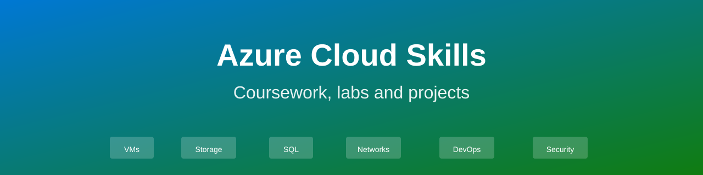

<p align="center">
  
</p>

<p align="center">
  
  
  
  
  
</p>

This repository documents coursework in Azure cloud computing and hands-on projects. It contains study guides for each service area, practical lab write-ups with submitted evidence, and projects that demonstrate enterprise-scale cloud architecture patterns.

## Contents

- [At a glance](#at-a-glance)
- [Repository structure](#repository-structure)
- [Skills and evidence](#skills-and-evidence)
- [Hands-on labs](#hands-on-labs)
- [Featured project](#featured-project)
- [Service modules](#service-modules)
- [Security](#security)
- [Roadmap](#roadmap)
- [About](#about)

## At a glance

| | |
|---|---|
| **Labs** | Hands-on Azure service demonstrations |
| **Study guides** | Azure services from fundamentals to enterprise patterns |
| **Project** | Enterprise-scale Azure infrastructure and DevOps automation |
| **Region** | Primary: `East US` |
| **Tools** | Azure Portal, Azure CLI, PowerShell, Terraform, Python |

## Repository structure

```text
.
|-- assets/                  Banner image
|-- modules/                 Service guides and study materials
|   |-- 01-fundamentals/
|   |-- 02-compute/
|   |-- 03-storage/
|   |-- 04-databases/
|   |-- 05-networking/
|   |-- 06-devops/
|   `-- 07-security/
|-- labs/                    Hands-on lab work with evidence
|   |-- lab-01-*/
|   |-- lab-02-*/
|   `-- ...
`-- projects/
    `-- enterprise-architecture/  Large-scale infrastructure and automation
        |-- terraform/
        |-- scripts/
        `-- documentation/
```

## Skills and evidence

| Area | Services and tools | Study guide | Evidence |
|---|---|---|---|
| Fundamentals | Resource groups, subscriptions, Azure hierarchy, cost management | [Module 1](modules/01-fundamentals/) | Lab materials |
| Compute | Virtual machines, App Service, container instances, scale sets | [Module 2](modules/02-compute/) | Hands-on labs |
| Storage | Blob Storage, File Shares, managed disks, backup and recovery | [Module 3](modules/03-storage/) | Lab evidence |
| Databases | SQL Database, Cosmos DB, database migration, replication | [Module 4](modules/04-databases/) | Lab documentation |
| Networking | Virtual networks, subnets, NSGs, load balancers, VPN, ExpressRoute | [Module 5](modules/05-networking/) | Architecture diagrams |
| DevOps | Azure Pipelines, Git repos, infrastructure as code, release management | [Module 6](modules/06-devops/) | Project artifacts |
| Security | Identity, access control, encryption, compliance, monitoring | [Module 7](modules/07-security/) | Security best practices |

## Hands-on labs

Each lab demonstrates one or more Azure services in a practical scenario.

| Lab | Topic | Evidence |
|---|---|---|
| Lab 1 | Azure fundamentals: resources, groups, subscriptions | [README](labs/lab-01-fundamentals/) |
| Lab 2 | Virtual machines and scale sets | [README](labs/lab-02-vms/) |
| Lab 3 | Storage and data management | [README](labs/lab-03-storage/) |
| Lab 4 | Networking and connectivity | [README](labs/lab-04-networking/) |
| Lab 5 | Databases and replication | [README](labs/lab-05-databases/) |
| Lab 6 | App Service and containers | [README](labs/lab-06-appservice/) |

## Featured project

**[Enterprise Azure Architecture](projects/enterprise-architecture/)** demonstrates Infrastructure as Code patterns, multi-region deployment, and DevOps practices. It includes Terraform modules for compute, networking, and storage, along with Azure Pipelines for continuous integration and automated infrastructure provisioning.

## Service modules

| # | Module | Focus |
|---|---|---|
| 1 | [Azure Fundamentals](modules/01-fundamentals/) | Azure hierarchy, resource management, cost control |
| 2 | [Compute Services](modules/02-compute/) | VMs, App Service, containers, scale sets |
| 3 | [Storage Services](modules/03-storage/) | Blob Storage, File Shares, managed disks, backup |
| 4 | [Database Services](modules/04-databases/) | SQL Database, Cosmos DB, migration, replication |
| 5 | [Networking](modules/05-networking/) | VNets, subnets, NSGs, load balancing, connectivity |
| 6 | [DevOps and Automation](modules/06-devops/) | Pipelines, repos, infrastructure as code, monitoring |
| 7 | [Security and Compliance](modules/07-security/) | Identity, access, encryption, audit logging |

## Security

Lab submissions and evidence materials have been reviewed for sensitive data. Subscription IDs, keys, connection strings, and personal information have been redacted from all documents.

## Roadmap

- [ ] Complete Azure fundamentals certification labs
- [ ] Build multi-region Terraform configuration with failover
- [ ] Add architecture decision records (ADRs)
- [ ] Implement monitoring and alerts with Azure Monitor
- [ ] Create migration case study from on-premises to Azure
- [ ] Add governance and policy as code examples

## About

This repository documents Azure cloud computing coursework and hands-on projects. It serves as both a record of work completed and a reference guide for enterprise Azure architecture patterns. Feedback and suggestions are welcome through [GitHub issues](https://github.com/mmm-byte/Cloud_Computing_Azure/issues).
